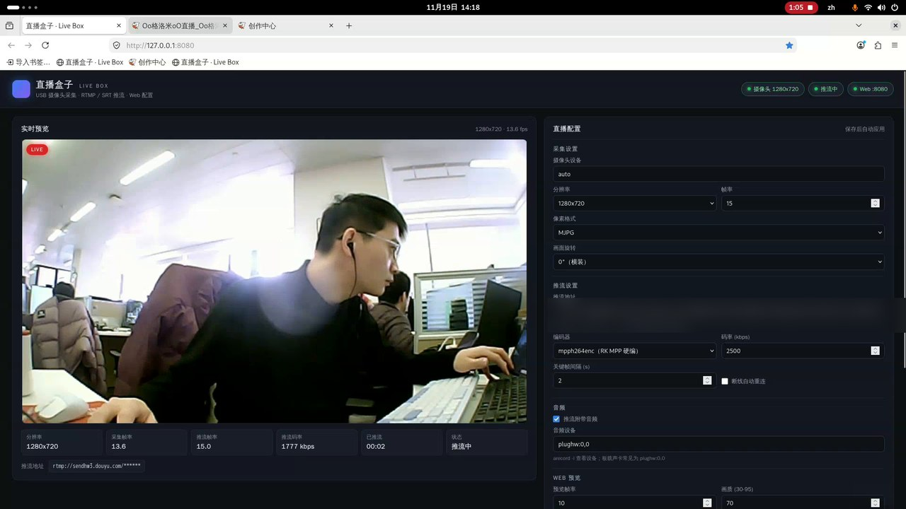
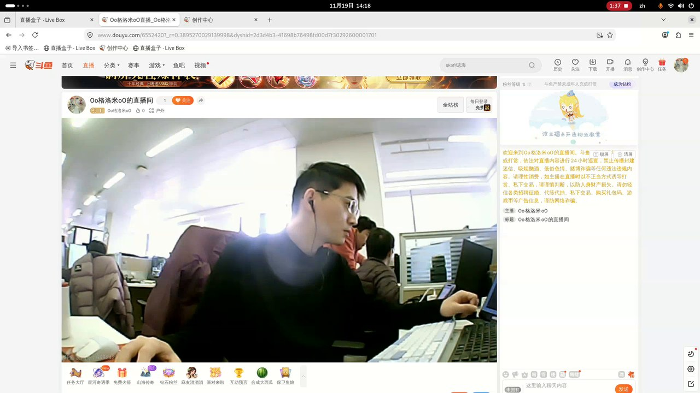

# 直播盒子 Demo（RK3576）

[English](README_EN.md) | 简体中文

基于 Quectel Pi M2（RK3576）的 USB 摄像头直播盒子：摄像头采集 → H.264 编码 →
RTMP/SRT 推流到直播平台。带显示屏时自动打开本地预览窗口，不带显示屏时通过
Web 控制台预览画面、调整参数并控制推流。

| Web 控制台（实时预览 + 参数配置） | 推流到斗鱼直播间 |
| --- | --- |
|  |  |

## 功能特性

- USB UVC 摄像头采集，默认 MJPG 1280x720@15fps，自动定位 `/dev/v4l/by-id/*usb*`
- RTMP / RTMPS / SRT 推流，断线自动重连
- 两种编码后端：
  - `libx264`：软件编码（GStreamer `x264enc`），开箱即用
  - `mpph264enc`：Rockchip MPP 硬件编码（GStreamer appsrc），CPU 占用低
- 本地预览窗口（OpenCV）与 Web MJPEG 预览可同时使用
- Web 控制台可修改分辨率、帧率、码率、编码器、推流地址、音频，保存即生效
- 实时显示推流码率、发送帧率、时长与运行日志（推流密钥自动打码）
- 可选音频推流，默认使用板载声卡 `plughw:0,0`

## 目录结构

```
demo-live-box/
├── main.py            # 入口：采集、推流、Web 控制台、本地预览
├── camera.py          # V4L2 采集线程（单实例独占摄像头）
├── streamer.py        # 推流器：GStreamer(x264enc 软编 / mpph264enc 硬编)
├── webui.py           # Web 控制台 + MJPEG 预览（仅标准库）
├── ui.py              # 本地预览窗口
├── selftest.py        # 板端自检（摄像头 / 音频 / 本地 5s 编码）
├── config.json        # 配置文件（JSON）
├── run.sh             # 启动脚本（自动借用桌面 XWayland 授权）
├── deploy/
│   ├── board_setup.sh # 板端环境检查（只检查，不修改系统）
│   └── deploy.sh      # PC 端：通过 adb 推送到 /opt/demo_live_box
├── images/            # README 演示截图
└── records/           # 自检输出
```

## 硬件与环境要求

- Quectel Pi M2 / RK3576 开发板，Debian 13（aarch64）
- USB UVC 摄像头（推荐支持 MJPG 720p）
- 可选：HDMI 显示屏（使用本地预览窗口）
- 板子可访问公网（推流到斗鱼/B 站等平台时需要）
- 音频推流需要可用的 ALSA 输入设备（板载麦或 USB 麦克风）

## 快速开始

### 1. 克隆仓库

在开发板上执行：

```bash
git clone https://github.com/Quectel-Pi/demo-live-box.git
cd demo-live-box
```

### 2. 检查环境

```bash
bash deploy/board_setup.sh
```

脚本会打印系统架构、`ffmpeg` / `v4l2-ctl` / `arecord` / `python3-opencv`
是否可用、USB 摄像头节点、音频输入、显示接口和 8080 端口占用情况。
该脚本只做检查，不会安装或修改任何东西。

### 3. 安装依赖

如果检查结果有 `MISS`，按需安装（板子需联网）：

```bash
sudo apt update
sudo apt install -y python3-opencv ffmpeg v4l-utils alsa-utils
```

如需使用 Rockchip MPP 硬件编码，确认 GStreamer 与 MPP 插件可用：

```bash
gst-inspect-1.0 mpph264enc
```

> RK3576 官方镜像通常已自带 Rockchip MPP 与 `mpph264enc`。若该命令不存在，
> 请先使用 `libx264` 软编；也可安装 `python3-gi`、`gstreamer1.0-tools`、
> `gstreamer1.0-plugins-base/good/bad` 及 Rockchip MPP 插件后再试。
>
> 软编同样优先使用 GStreamer 的 `x264enc`（`gstreamer1.0-plugins-ugly`），
> 缺失时会自动回退到 ffmpeg 软编。

### 4. 启动

```bash
# 有显示屏：本地预览窗口 + Web 控制台
./run.sh

# 无显示屏（纯 Web 预览）
./run.sh --no-ui

# 启动后按 config.json 中的地址自动推流
./run.sh --start
```

启动后终端会打印 Web 控制台地址，例如：

```
[web] 预览 / 配置页面: http://192.168.1.100:8080
```

> `run.sh` 会自动设置 `DISPLAY` 并借用桌面用户的 XWayland 授权；如果直接
> `python3 main.py`，需要自行保证图形环境变量正确。

### 5. 打开 Web 控制台

在同一局域网的电脑/手机浏览器访问 `http://<板子IP>:8080`，即可看到实时
MJPEG 预览和全部配置项。端口可通过 `config.json` 的 `web.port` 修改
（修改后需重启进程）。

## 推流操作（以斗鱼为例）

1. 登录直播平台后台，进入“开播/推流设置”，获取 **推流地址**（RTMP URL，含密钥）。
2. 打开 Web 控制台，在“推流设置”中填入推流地址。
3. 选择编码器：
   - `libx264（软编）`：兼容性最好；
   - `mpph264enc（RK MPP 硬编）`：使用 RK3576 VPU，CPU 占用更低。
4. 设置码率（720p 推荐 2000~3000 kbps）、关键帧间隔（默认 2s）。
5. 如需声音，勾选“推流附带音频”，音频设备填 `plughw:0,0`（用 `arecord -l` 确认）。
6. 点击 **保存并应用**，再点击 **开始推流**。
7. 状态变为 `LIVE` 后，在平台直播间即可看到画面；推流码率/帧率/时长会实时刷新。
8. 结束演示时点击 **停止推流**。

常见平台的推流地址格式：

| 平台 | 地址格式 |
| --- | --- |
| 斗鱼 | `rtmp://sendhw3.douyu.com/live/<推流码>?...&wsSecret=...` |
| B 站 | `rtmp://live-push.bilivideo.com/live-bvc/<key>` |
| 抖音 | `rtmp://push-rtmp-*.douyincdn.com/third/<key>` |
| YouTube | `rtmp://a.rtmp.youtube.com/live2/<key>` |
| 自建 SRS / MediaMTX | `rtmp://<ip>:1935/live/test` 或 `srt://<ip>:10080` |

> 推流地址与密钥以平台后台“推流信息”为准，且可能随开播场次变化。
> Web 控制台的运行日志和状态区会对密钥做打码处理。

## 参数说明（config.json）

| 键 | 说明 |
| --- | --- |
| `camera.device` | `auto`、序号 `73` 或 `/dev/video73` |
| `camera.width/height/fps` | 采集分辨率与帧率；USB 720p MJPG 通常最高 15fps |
| `camera.fourcc` | `MJPG`（推荐）或 `YUYV` |
| `camera.rotate` | 画面旋转 `0/90/180/270`（顺时针）；摄像头竖装时按需调整 |
| `stream.auto_start` | 启动后是否自动推流 |
| `stream.url` | `rtmp://`、`rtmps://` 或 `srt://` 地址 |
| `stream.encoder` | `libx264`（软编，默认）或 `mpph264enc`（MPP 硬编） |
| `stream.bitrate_kbps` | 视频码率，默认 2500 |
| `stream.gop_seconds` | 关键帧间隔（秒） |
| `stream.audio.enabled` | 是否推音频 |
| `stream.audio.device` | ALSA 设备，默认 `plughw:0,0` |
| `stream.audio.bitrate_kbps` | 音频码率，默认 96 |
| `stream.auto_reconnect` | 推流断开后是否自动重连 |
| `web.host/port` | Web 控制台监听地址与端口（默认 `0.0.0.0:8080`） |
| `web.preview_fps/quality` | MJPEG 预览帧率与 JPEG 画质 |
| `preview.enabled` | 是否启用本地预览窗口（`--no-ui` 可强制关闭） |
| `preview.window_w` | 本地预览窗口宽度 |

## 本地预览按键

| 按键 | 功能 |
| --- | --- |
| `S` | 开始 / 停止推流 |
| `R` | 在终端打印 Web 控制台地址 |
| `Q` / `ESC` | 退出程序 |

## 自检

```bash
python3 selftest.py
```

检查 ffmpeg / 编码器 / 摄像头出帧 / JPEG 编码 / 音频设备，并做一次 5 秒
本地 H.264 编码，样片输出到 `records/selftest.flv`，不需要推流平台。
使用硬编时，自检会检查 `gst-inspect-1.0 mpph264enc` 是否可用。

## PC 端 adb 部署（可选）

除了在板端直接 `git clone`，也可以在 PC 上通过 adb 推送：

```bash
bash deploy/deploy.sh
```

脚本会把代码、配置和 `deploy/board_setup.sh` 打包推送到板端
`/opt/demo_live_box`，然后可执行：

```bash
adb shell '/opt/demo_live_box/run.sh'
adb shell '/opt/demo_live_box/run.sh --no-ui'
```

## 自建直播服务（可选）

没有平台账号时，可以在板端或局域网服务器安装
[MediaMTX](https://github.com/bluenviron/mediamtx)：

- 推流地址：`rtmp://<ip>:1935/live/test`
- WebRTC 观看：`http://<ip>:8889/live/test`
- HLS 观看：`http://<ip>:8888/live/test/index.m3u8`

把推流地址填入 Web 控制台即可，无需任何平台密钥。

## 常见问题

- **摄像头打不开**：`v4l2-ctl --list-devices` 确认 UVC 节点；设备可能被其他
  进程占用，先停止占用程序；`camera.device` 填具体节点更稳定。
- **Web 控制台打不开**：确认板子与电脑同网段，`ss -ltn | grep 8080` 检查监听；
  端口冲突时修改 `web.port` 并重启。
- **没有显示屏**：使用 `./run.sh --no-ui`，通过浏览器访问 Web 控制台预览。
- **推流失败**：查看 Web 日志面板中的错误；依次检查推流地址/密钥、网络连通性、
  平台是否要求 `rtmps`，以及 1935 端口是否被网络拦截。
- **硬编报错**：RK3576 不支持 ffmpeg 的 `h264_v4l2m2m`，请选择 `mpph264enc`；
  若 `gst-inspect-1.0 mpph264enc` 不存在，则改用 `libx264`。
- **没有声音**：`arecord -l` 确认输入设备；桌面 PipeWire 占用声卡时可使用
  `plughw:0,0`，或关闭音频推流。
- **画面卡顿/码率过高**：720p 建议 2000~3000 kbps；网络较差时降到
  960x540 / 640x480 或降低帧率。

## License

本 Demo 仅用于产品演示与技术验证，请遵守直播平台的服务条款。
