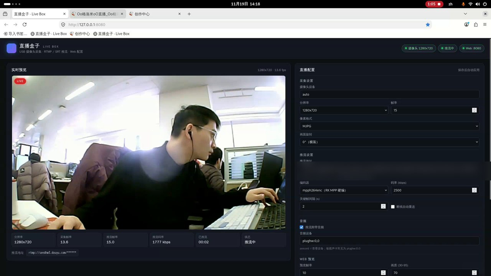
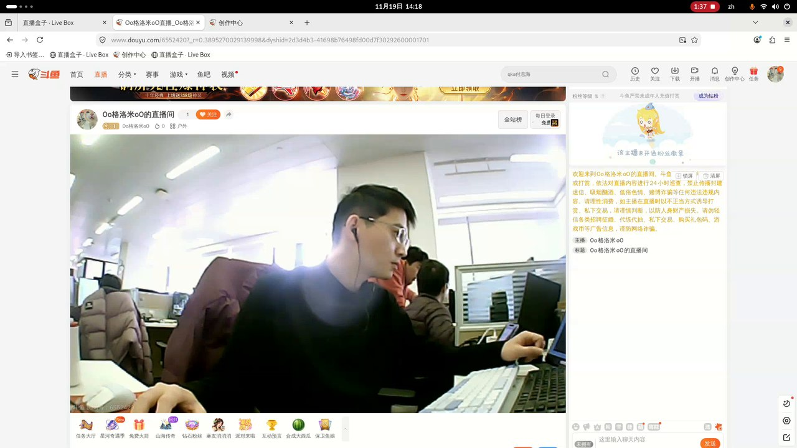

# Live Box Demo (RK3576)

English | [简体中文](README.md)

A USB-camera live streaming box built on Quectel Pi M2 (RK3576): camera capture →
H.264 encoding → RTMP/SRT streaming to live platforms. With a display, a local
preview window opens automatically; without a display, use the Web console to
preview the video, change parameters, and control streaming.

| Web console (live preview + configuration) | Streaming to Douyu |
| --- | --- |
|  |  |

## Features

- USB UVC camera capture, MJPG 1280x720@15fps by default, auto-detects `/dev/v4l/by-id/*usb*`
- RTMP / RTMPS / SRT streaming with automatic reconnection
- Two encoding backends:
  - `libx264`: software encoding, works out of the box
  - `mpph264enc`: Rockchip MPP hardware encoding (GStreamer appsrc), low CPU usage
- Local OpenCV preview and Web MJPEG preview can run at the same time
- Web console edits resolution, frame rate, bitrate, encoder, stream URL, and audio; changes apply on save
- Real-time bitrate / sent FPS / uptime and logs (stream keys are masked automatically)
- Optional audio streaming; uses onboard codec `plughw:0,0` by default

## Repository Layout

```
demo-live-box/
├── main.py            # Entry: capture, streaming, web console, local preview
├── camera.py          # V4L2 capture thread (exclusive camera access)
├── streamer.py        # Streamer: ffmpeg (libx264) / GStreamer (mpph264enc)
├── webui.py           # Web console + MJPEG preview (standard library only)
├── ui.py              # Local preview window
├── selftest.py        # Board self-test (camera / audio / 5s local encode)
├── config.json        # Configuration file (JSON)
├── run.sh             # Launcher (reuses the desktop user's XWayland auth)
├── deploy/
│   ├── board_setup.sh # Board environment check (read-only)
│   └── deploy.sh      # PC: push to /opt/demo_live_box via adb
├── images/            # README screenshots
└── records/           # Self-test output
```

## Hardware & Requirements

- Quectel Pi M2 / RK3576 board, Debian 13 (aarch64)
- USB UVC camera (MJPG 720p recommended)
- Optional: HDMI display for the local preview window
- Internet access for streaming to Douyu / Bilibili / YouTube, etc.
- An available ALSA input device for audio (onboard mic or USB microphone)

## Quick Start

### 1. Clone the repository

On the board:

```bash
git clone https://github.com/Quectel-Pi/demo-live-box.git
cd demo-live-box
```

### 2. Check the environment

```bash
bash deploy/board_setup.sh
```

It prints the CPU architecture, availability of `ffmpeg` / `v4l2-ctl` /
`arecord` / `python3-opencv`, USB camera nodes, audio inputs, display connectors,
and whether port 8080 is in use. The script only checks; it does not modify the system.

### 3. Install dependencies

If the check reports `MISS`, install what you need (the board needs internet):

```bash
sudo apt update
sudo apt install -y python3-opencv ffmpeg v4l-utils alsa-utils
```

To use Rockchip MPP hardware encoding, make sure GStreamer and the MPP plugin
are available:

```bash
gst-inspect-1.0 mpph264enc
```

> RK3576 official images usually ship Rockchip MPP and `mpph264enc` already.
> If the command is missing, use `libx264` first, or install `python3-gi`,
> `gstreamer1.0-tools`, `gstreamer1.0-plugins-base/good/bad`, and the Rockchip
> MPP plugins.

### 4. Run

```bash
# With a display: local preview window + web console
./run.sh

# Headless (web preview only)
./run.sh --no-ui

# Start streaming automatically using the URL in config.json
./run.sh --start
```

The terminal prints the Web console URL, for example:

```
[web] 预览 / 配置页面: http://192.168.1.100:8080
```

> `run.sh` sets `DISPLAY` and reuses the desktop user's XWayland authorization.
> If you run `python3 main.py` directly, make sure the graphical environment is
> configured correctly.

### 5. Open the Web console

Visit `http://<board-ip>:8080` from a PC or phone on the same LAN. You will see
the live MJPEG preview and all settings. Change the port via `web.port` in
`config.json` (restart required).

## Streaming (Douyu example)

1. Sign in to the platform's creator/streaming page and copy the **stream URL**
   (an RTMP URL that contains the stream key).
2. Open the Web console and paste the URL into **Stream settings**.
3. Choose an encoder:
   - `libx264` (software): best compatibility;
   - `mpph264enc` (RK MPP hardware): uses the RK3576 VPU with lower CPU usage.
4. Set the bitrate (2000–3000 kbps for 720p) and keyframe interval (2s by default).
5. To include audio, enable **Stream audio** and set the device to `plughw:0,0`
   (check with `arecord -l`).
6. Click **Save & Apply**, then **Start streaming**.
7. When the state becomes `LIVE`, the platform's live room shows the video.
   Bitrate, FPS, and uptime update in real time.
8. Click **Stop streaming** when finished.

Common stream URL formats:

| Platform | URL format |
| --- | --- |
| Douyu | `rtmp://sendhw3.douyu.com/live/<stream-key>?...&wsSecret=...` |
| Bilibili | `rtmp://live-push.bilivideo.com/live-bvc/<key>` |
| Douyin | `rtmp://push-rtmp-*.douyincdn.com/third/<key>` |
| YouTube | `rtmp://a.rtmp.youtube.com/live2/<key>` |
| Self-hosted SRS / MediaMTX | `rtmp://<ip>:1935/live/test` or `srt://<ip>:10080` |

> Always use the stream information shown in the platform's creator dashboard;
> URLs and keys can change per session. The Web console masks keys in logs and
> status output.

## Configuration (config.json)

| Key | Description |
| --- | --- |
| `camera.device` | `auto`, index `73`, or `/dev/video73` |
| `camera.width/height/fps` | Capture resolution and frame rate; USB 720p MJPG is usually limited to 15fps |
| `camera.fourcc` | `MJPG` (recommended) or `YUYV` |
| `camera.rotate` | Rotation `0/90/180/270` (clockwise); adjust for vertically mounted cameras |
| `stream.auto_start` | Start streaming on launch |
| `stream.url` | `rtmp://`, `rtmps://`, or `srt://` URL |
| `stream.encoder` | `libx264` (default) or `mpph264enc` (MPP hardware) |
| `stream.bitrate_kbps` | Video bitrate, default 2500 |
| `stream.gop_seconds` | Keyframe interval in seconds |
| `stream.audio.enabled` | Enable audio streaming |
| `stream.audio.device` | ALSA device, default `plughw:0,0` |
| `stream.audio.bitrate_kbps` | Audio bitrate, default 96 |
| `stream.auto_reconnect` | Reconnect automatically after a drop |
| `web.host/port` | Web console bind address and port (default `0.0.0.0:8080`) |
| `web.preview_fps/quality` | MJPEG preview frame rate and JPEG quality |
| `preview.enabled` | Enable the local preview window (`--no-ui` forces it off) |
| `preview.window_w` | Local preview window width |

## Local Preview Keys

| Key | Action |
| --- | --- |
| `S` | Start / stop streaming |
| `R` | Print the Web console URL |
| `Q` / `ESC` | Quit |

## Self-test

```bash
python3 selftest.py
```

The self-test checks ffmpeg, the encoder, camera frames, JPEG encoding, and the
audio device, then performs a 5-second local H.264 encode to
`records/selftest.flv`. No streaming platform is required. With the hardware
encoder selected, it checks `gst-inspect-1.0 mpph264enc` instead of an ffmpeg
encoder.

## PC-side adb Deployment (Optional)

Instead of cloning on the board, you can push the demo from a PC over adb:

```bash
bash deploy/deploy.sh
```

The script packages the code, config, and `deploy/board_setup.sh` into
`/opt/demo_live_box` on the board. Then run:

```bash
adb shell '/opt/demo_live_box/run.sh'
adb shell '/opt/demo_live_box/run.sh --no-ui'
```

## Self-hosted Streaming (Optional)

Without a platform account, install
[MediaMTX](https://github.com/bluenviron/mediamtx) on the board or a LAN server:

- Publish: `rtmp://<ip>:1935/live/test`
- WebRTC playback: `http://<ip>:8889/live/test`
- HLS playback: `http://<ip>:8888/live/test/index.m3u8`

Paste the publish URL into the Web console. No platform key is needed.

## Troubleshooting

- **Camera won't open**: check `v4l2-ctl --list-devices`; the device may be used
  by another process. Stop it, or set `camera.device` to a specific node.
- **Web console unreachable**: make sure the board and your PC are on the same
  LAN; check `ss -ltn | grep 8080`; change `web.port` if it conflicts.
- **No display**: run `./run.sh --no-ui` and use the Web preview.
- **Streaming fails**: read the Web log panel; verify the URL/key, network
  connectivity, whether the platform requires `rtmps`, and whether port 1935 is
  blocked.
- **Hardware encoder errors**: RK3576 does not support ffmpeg's `h264_v4l2m2m`;
  select `mpph264enc`. If `gst-inspect-1.0 mpph264enc` is missing, use `libx264`.
- **No audio**: check `arecord -l`; if the desktop PipeWire session holds the
  sound card, use `plughw:0,0` or disable audio streaming.
- **Stuttering / bitrate too high**: use 2000–3000 kbps for 720p; lower the
  resolution to 960x540 / 640x480 or reduce the frame rate on weak networks.

## License

This demo is provided for product demonstration and technical validation only.
Please follow the terms of service of your streaming platform.
